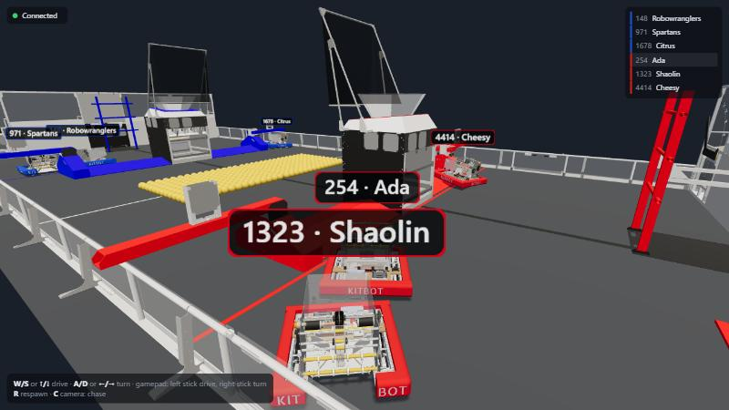
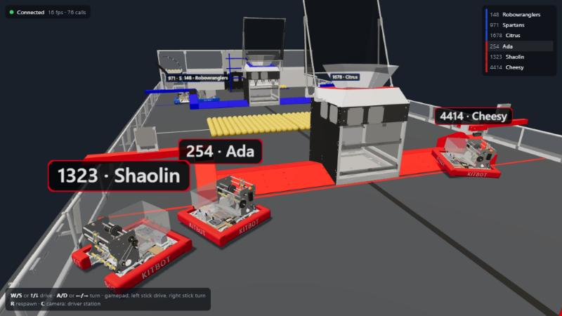
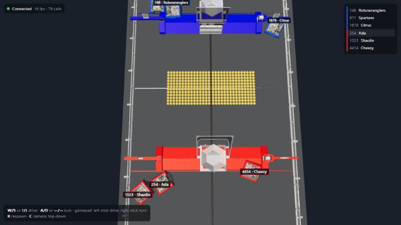

# FRC 2026 LAN Sim

A multiplayer driving simulator for the **2026 FRC game (REBUILT)**. Up to six people on the same local
network open a web page in Chrome, choose a name, team number and alliance, and drive a **2026 KitBot**
around the **official 2026 field CAD** while seeing each other live.

This version is driving only: no shooting, intake, scoring or match timer.



| Join screen | Driver-station camera | Top-down camera |
|---|---|---|
|  |  |  |

---

## Quick start

**Requirements:** [Node.js](https://nodejs.org/) 22 or newer on the host computer, and Google Chrome on
every player's computer. All players must be on the same LAN or Wi-Fi network as the host.

```bash
npm install
```

```bash
npm start
```

The server prints the address each player should open, for example:

```
FRC sim listening. LAN URLs:
  http://192.168.1.44:3000
```

1. On each player's computer, open the printed `http://<host-ip>:3000` address in Chrome. The host
   computer can also use `http://localhost:3000`.
2. Wait for the progress bar to fill. The page downloads about 39 MB of 3D models once.
3. Enter a name (1–16 characters), a team number (1–99999), and pick **Red** or **Blue**.
4. Click **Drive!**

> **Windows:** the first time you run `npm start`, Windows Firewall asks whether Node.js may communicate.
> Allow it on **Private networks**, or other computers will not be able to connect.
>
> **Use the IP address**, not a computer name. `http://mypc.local:3000` is refused on purpose (see
> [LAN-only security](#lan-only-security)).

To use a different port:

```bash
PORT=8080 npm start
```

On Windows PowerShell, use `$env:PORT=8080; npm start` instead.

---

## Controls

| Action | Keyboard | Gamepad (Xbox-style) |
|---|---|---|
| Drive forward / back | `W` / `S` or `↑` / `↓` | Left stick, up/down |
| Turn left / right | `A` / `D` or `←` / `→` | Right stick, left/right |
| Respawn at your alliance's start | `R` | — |
| Change camera | `C` | — |

The robot uses **arcade drive** on a differential (tank) drivetrain, like the real KitBot. Its top speed
is 3.8 m/s and it turns at up to 5 rad/s, with acceleration limits so it doesn't feel like it teleports.

Chrome only lets a page read a gamepad after you press a button on it while the page is focused. The
gamepad must report Chrome's "standard" mapping (Xbox and most modern pads do), and it overrides the
keyboard while its sticks are outside the 10 % deadband.

**Camera modes** (`C` cycles):
- **Chase:** behind your robot.
- **Driver station:** behind your alliance wall, the view a real FRC driver has.
- **Top-down:** the whole field, with your alliance wall at the bottom.

If the browser tab loses focus or is hidden, your robot stops. If the connection drops, you return to the
join screen with your details filled in; click **Drive!** again to rejoin.

---

## Rules of the sim

- **3 robots per alliance, 6 total.** A 4th player on a full alliance is told the alliance is full.
- Robots collide with each other, with the **hubs**, the **towers**, the **trench side skirts** and the
  **field perimeter**.
- The **bumps** next to each hub are drivable. Your robot visually rides up and over them.
- The **trench** lanes along the side walls are open to drive under.
- The server owns all physics. Every player sees the same positions, updated 30 times a second and
  smoothed with 100 ms of interpolation.

---

## The 3D models

| Model | Source |
|---|---|
| `public/assets/field2026.glb` | FIRST's official 2026 REBUILT field CAD, in the glTF export published by the AdvantageScope project ([`Field3d_2026FRCFieldV2`](https://github.com/Mechanical-Advantage/AdvantageScopeAssets/releases/tag/archive-v1)) |
| `public/assets/kitbot2026.glb` | FIRST's official 2026 KitBot CAD, AdvantageScope export ([`Robot_2026FRCKitBotV2`](https://github.com/Mechanical-Advantage/AdvantageScopeAssets/releases/tag/archive-v1)) |

The models are committed to the repo, so the sim works on a LAN with no internet access.

The browser does some processing after loading the models, so a mid-range GPU can run them:
- The field's ~2,900 parts are merged by material into 28 meshes.
- Each robot is reduced to 4 meshes.
- The bumper fabric is recoloured red or blue by alliance.

The field's collision shapes and spawn points (`shared/field.js`) were measured from the field CAD with
`tools/inspect-glb.mjs`:
- slice the field geometry at bumper height;
- rasterise it into a grid;
- fit rectangles to the solid parts, checked against the AprilTag positions.

`docs/geometry-debug.svg` shows the result over the measured grid.

---

## LAN-only security

The server listens on all interfaces but only serves the local network:

- **Source address:** requests are accepted only from private and loopback addresses: `10/8`,
  `172.16/12`, `192.168/16`, `127/8`, `169.254/16`, `::1`, `fc00::/7` and `fe80::/10`. Everything else
  gets `403`.
- **Host header:** it must be an IP address or `localhost`, which blocks DNS-rebinding attacks.
- **WebSocket origin:** the WebSocket's `Origin` must match the page's own host, so an internet page
  can't drive a robot through a player's browser.
- **Abuse limits:** at most 12 open connections, 1 KB per message and 60 messages/s per player. A
  connection that never joins is dropped after 5 s, and dead connections are found by ping within about
  4 s.
- **Input validation:** every message is validated. Names are rendered as plain text only.

There are no accounts, nothing is stored on disk, and the server never contacts the internet.

---

## Project layout

```
server/
  index.js      HTTP static server + WebSocket game server (LAN filter, protocol, 60 Hz sim loop, 30 Hz broadcast)
  sim.js        Pure 2D simulation: differential drive, SAT collisions, spawns
  lan.js        Private-address, Host and Origin checks
shared/
  field.js      Field size, robot size, obstacles, bumps, spawns, model placement (used by server AND browser)
public/
  index.html    Join screen + HUD (three.js loaded through an import map from /vendor/three/)
  js/main.js    Join flow, WebSocket, interpolation, HUD
  js/world.js   Renderer, lights, cameras, robots, labels, bump tilt
  js/models.js  GLB loading and merging
  js/input.js   Keyboard + gamepad
  assets/       The 2026 field and KitBot models
tools/
  inspect-glb.mjs   CAD inspector used to derive shared/field.js
test/           node:test suites (sim, LAN filter, integration, field geometry)
docs/
  images/       Screenshots
  state/        Design doc and project state / decisions
```

**Coordinate frame:** metres, origin at field centre, `+x` toward the red alliance wall, heading in
radians counter-clockwise.

**Wire protocol:** JSON over WebSocket at `/ws`. See `docs/state/frc-sim_design.md`.

---

## Development

```bash
npm test
```

The suite has 34 tests across four files:
- **Simulation:** driving, slew limits, obstacle, robot and perimeter collisions, input timeout, spawns,
  alliance cap.
- **LAN, Host and Origin filters.**
- **Live server integration:** two clients seeing each other move, rejects, path traversal,
  connection cap, message-rate limit, DNS-rebinding refusal.
- **Field geometry:** obstacles inside the field, spawns clear, and the CAD's blue structures on the blue
  side.

Dependencies:
- **Runtime:** `three` and `ws` only.
- **No build step:** the browser loads ES modules directly.

**Tuning:**
- **Robot speed and acceleration:** the top of `server/sim.js`.
- **Obstacles and spawns:** `shared/field.js`.
- **Lighting and cameras:** `public/js/world.js`.

### Not in this version
- Shooting, intake and FUEL game pieces. The FUEL in the field model is scenery only.
- Scoring and the match timer.
- Spectators.
- Client-side prediction. On a LAN, latency is a few milliseconds.
- Mobile and touch controls.
- Internet play.
