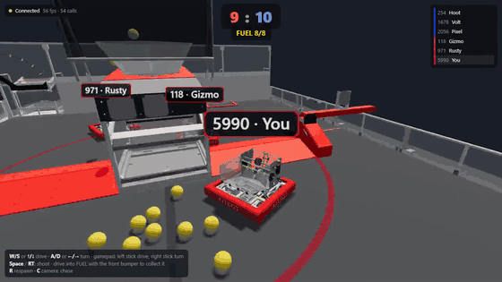
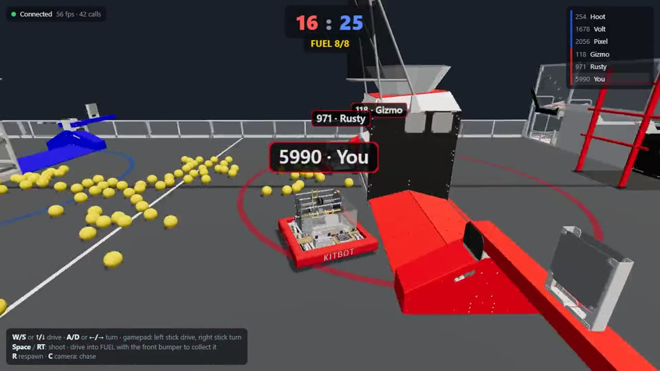
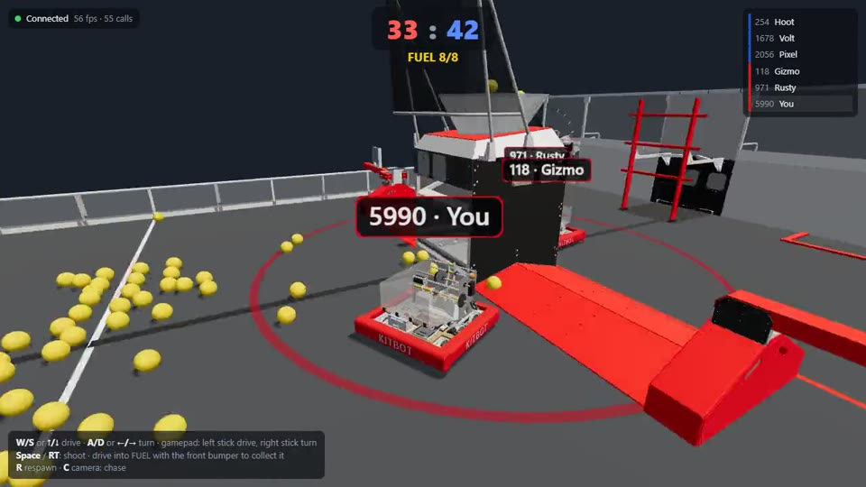
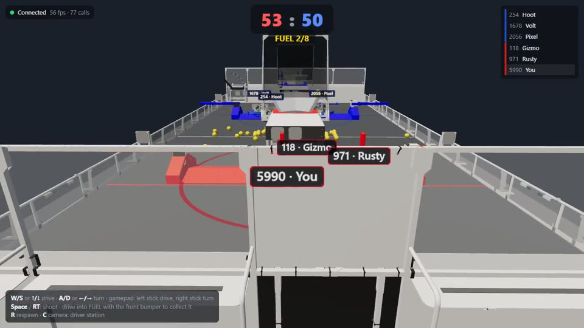
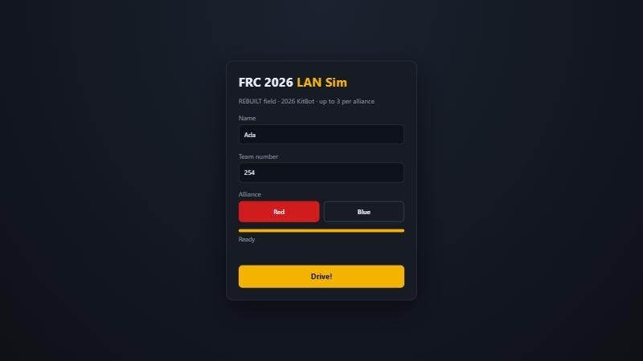
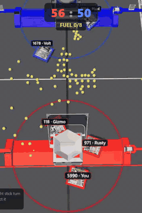

<div align="center">

# FRC 2026 LAN Sim

**A multiplayer FRC robot simulator on the real 2026 REBUILT field, in your browser, on your LAN.**

Drive a 2026 KitBot, scoop up FUEL and shoot it into your HUB, with up to six friends on the same network.<br>
No install for players: open a link in Chrome and drive.




**[▶ Watch the full 60-second gameplay video](docs/media/gameplay.mp4)**

</div>

---

## Highlights

- 🏟️ **Real field CAD:** FIRST's official 2026 REBUILT field, with hubs, bumps, trenches and towers you collide with.
- 🤖 **Real robot CAD:** the official 2026 KitBot, bumpers recoloured red or blue by alliance.
- 🟡 **Collect and shoot:** drive into FUEL with your front bumper, then hold Space to shoot it into your HUB.
- 👥 **3v3 multiplayer:** a server-authoritative 60 Hz simulation, so every player sees the same match.
- 🎥 **Three cameras:** chase, driver station (the real driver's view) and top-down.
- 🎮 **Keyboard or gamepad.**
- 🔒 **LAN only by design:** private addresses only, DNS-rebinding and cross-site WebSocket protection.
- 📦 **Zero build step:** two runtime dependencies (`three`, `ws`), and it works on a LAN with no internet.

## Gallery

| Collecting FUEL | Shooting at the hub |
|---|---|
|  |  |
| **Driver-station camera** | **Join screen** |
|  |  |

<table>
<tr>
<td width="260"></td>
<td>

**Top-down camera** (sped up 2×).

The red alliance scores in the red hub at the bottom and blue in the blue hub at the top. Robots collect FUEL
in the neutral zone, return to their side over the bumps and shoot from the 2.5 m ring.

Full-size still: [05-top-down.jpg](docs/images/05-top-down.jpg)

</td>
</tr>
</table>

---

## ✨ Built by Claude, from these prompts

This whole repository was written by **Claude Code (Claude Opus 5.5)** from the four prompts below, typed by the
project owner and copied here word for word, typos and all. Nothing else was typed by a human: no code, no
geometry, no tests, no docs.

> **Prompt 1: build it**
>
> Build a multiplayer FRC simulator that lets users drive a simple robot in the 2026 FRC field.
> Please use the real CAD of the field from 2026's season, and make the robots look pretty similar to a simple FRC robot from that year.
> For now, the robots don't need to shoot any balls into the target, just drive.
> The users can join by opening the site on Chrome. It does not need to be a program, just a website. Only LAN connections should be supported, nothing more.
>
> Init a git repo in this folder and make sure to split your work into worktrees and commits as needed Be organized.
>
> Please give me VISUAL EXAMPLES of the game at the end, and a detailed README.md file on how to run/use this project.
>
> Use /dev-manager to orchestrate your work.

> **Prompt 2: add the game**
>
> Is it possible to add collecting and shooting balls at the target?
> And, please show me a gameplay of the game, not just screenshots
> Thank you!

> **Prompt 3: show it off**
>
> please make this a git repo with beautiful README with screenshots and videos, and INCLUDE THE PROMPTS I gave you there to show whats the power of Claude!

### What Claude did with them

**Prompt 1: lead plus a team of subagents**

- Acting as the lead (the `dev-manager` skill), Claude wrote a design contract, had it independently reviewed, and
  split the work into file-disjoint batches. Each batch ran in its own **git worktree and branch** (geometry,
  server, client) with its own implementer subagent.
- It found the official field and KitBot CAD, then **measured the collision geometry from the CAD itself**
  (`tools/inspect-glb.mjs`): it sliced the meshes at bumper height and checked the result against the AprilTag
  positions.
- Every batch got an **independent review by a separate agent**. One review found a crash a 13th LAN connection
  could cause. **Live tests in a real browser** caught a field model rotated 180° and a crash on join.

**Prompt 2: a second round, then a video**

- Claude extended the wire contract and ran the server batch (ball physics, intake, shooting, scoring) and the
  client batch (rendering, HUD, input) **in parallel**. It merged both and had the merged result reviewed.
- That review found balls that could get stuck inside the towers forever. It was fixed, and the fix was proved by
  sabotage: undo the fix, watch the new test go red, restore it.
- For the video, Claude wrote a **recorder**: five AI bots plus a real Chrome window, driven by the same AI through
  the Chrome DevTools Protocol, captured frame by frame and encoded with ffmpeg.

**Prompt 3: this README**

- The screenshots and GIFs come from that recording.

**By the numbers:**

| Metric | Count |
|---|---|
| Git commits, each with a clear message | 45+ |
| Merges from feature branches | 10 |
| Lines of JavaScript (server, client, tools, tests) | about 2,000 |
| Automated tests | 48 |
| Independent reviews | 6 |

The design, every decision Claude made on the owner's behalf (with its alternative), the review findings and the
validation evidence are all in [`docs/state/`](docs/state/).

---

## Quick start

**Requirements:** [Node.js](https://nodejs.org/) 22 or newer on the host computer, and Google Chrome on
every player's computer. All players must be on the same LAN or Wi-Fi network as the host.

```bash
npm install
```

```bash
npm start
```

The server prints the address each player should open, for example:

```
FRC sim listening. LAN URLs:
  http://192.168.1.44:3000
```

1. On each player's computer, open the printed `http://<host-ip>:3000` address in Chrome. The host
   computer can also use `http://localhost:3000`.
2. Wait for the progress bar to fill. The page downloads about 39 MB of 3D models once.
3. Enter a name (1–16 characters), a team number (1–99999), and pick **Red** or **Blue**.
4. Click **Drive!**

> **Windows:** the first time you run `npm start`, Windows Firewall asks whether Node.js may communicate.
> Allow it on **Private networks**, or other computers will not be able to connect.
>
> **Use the IP address**, not a computer name. `http://mypc.local:3000` is refused on purpose (see
> [LAN-only security](#lan-only-security)).

To use a different port:

```bash
PORT=8080 npm start
```

On Windows PowerShell, use `$env:PORT=8080; npm start` instead.

---

## Controls

| Action | Keyboard | Gamepad (Xbox-style) |
|---|---|---|
| Drive forward / back | `W` / `S` or `↑` / `↓` | Left stick, up/down |
| Turn left / right | `A` / `D` or `←` / `→` | Right stick, left/right |
| Respawn at your alliance's start | `R` | — |
| Shoot (hold) | `Space` | Right trigger or `A` |
| Change camera | `C` | — |

The robot uses **arcade drive** on a differential (tank) drivetrain, like the real KitBot. Its top speed
is 3.8 m/s and it turns at up to 5 rad/s, with acceleration limits so it doesn't feel like it teleports.

Chrome only lets a page read a gamepad after you press a button on it while the page is focused. The
gamepad must report Chrome's "standard" mapping (Xbox and most modern pads do), and it overrides the
keyboard while its sticks are outside the 10 % deadband.

**Camera modes** (`C` cycles):
- **Chase:** behind your robot.
- **Driver station:** behind your alliance wall, the view a real FRC driver has.
- **Top-down:** the whole field, with your alliance wall at the bottom.

If the browser tab loses focus or is hidden, your robot stops. If the connection drops, you return to the
join screen with your details filled in; click **Drive!** again to rejoin.

---

## Rules of the sim

- **3 robots per alliance, 6 total.** A 4th player on a full alliance is told the alliance is full.
- Robots collide with each other, with the **hubs**, the **towers**, the **trench side skirts** and the
  **field perimeter**.
- The **bumps** next to each hub are drivable. Your robot visually rides up and over them.
- The **trench** lanes along the side walls are open to drive under.
- **FUEL:** 100 balls start in the neutral zone. Drive into a ball with your **front bumper** to collect it
  (up to 8; the HUD shows `FUEL n/8`). Touching a ball with the side or back pushes it instead.
- **Shooting:** hold Space to fire 4 balls per second. The shooter is fixed (no aiming of speed or angle), so
  distance matters: shots from about **2.0–2.9 m** from the hub centre go in. The ring around each hub marks
  the 2.5 m sweet spot. Face the hub and shoot.
- **Scoring:** a ball that drops into a HUB scores 1 point for that hub's alliance (red hub is in front of the
  red spawns). The ball comes back out of the hub toward the field centre a second later. The score is shown at
  the top and resets only when the server restarts.
- The server owns all physics. Every player sees the same positions, updated 30 times a second and
  smoothed with 100 ms of interpolation.

---

## The 3D models

| Model | Source |
|---|---|
| `public/assets/field2026.glb` | FIRST's official 2026 REBUILT field CAD, in the glTF export published by the AdvantageScope project ([`Field3d_2026FRCFieldV2`](https://github.com/Mechanical-Advantage/AdvantageScopeAssets/releases/tag/archive-v1)) |
| `public/assets/kitbot2026.glb` | FIRST's official 2026 KitBot CAD, AdvantageScope export ([`Robot_2026FRCKitBotV2`](https://github.com/Mechanical-Advantage/AdvantageScopeAssets/releases/tag/archive-v1)) |

The models are committed to the repo, so the sim works on a LAN with no internet access.

The browser does some processing after loading the models, so a mid-range GPU can run them:
- The field's ~2,900 parts are merged by material into 28 meshes.
- Each robot is reduced to 4 meshes.
- The bumper fabric is recoloured red or blue by alliance.

The field's collision shapes and spawn points (`shared/field.js`) were measured from the field CAD with
`tools/inspect-glb.mjs`:
- slice the field geometry at bumper height;
- rasterise it into a grid;
- fit rectangles to the solid parts, checked against the AprilTag positions.

`docs/geometry-debug.svg` shows the result over the measured grid.

---

## LAN-only security

The server listens on all interfaces but only serves the local network:

- **Source address:** requests are accepted only from private and loopback addresses: `10/8`,
  `172.16/12`, `192.168/16`, `127/8`, `169.254/16`, `::1`, `fc00::/7` and `fe80::/10`. Everything else
  gets `403`.
- **Host header:** it must be an IP address or `localhost`, which blocks DNS-rebinding attacks.
- **WebSocket origin:** the WebSocket's `Origin` must match the page's own host, so an internet page
  can't drive a robot through a player's browser.
- **Abuse limits:** at most 12 open connections, 1 KB per message and 60 messages/s per player. A
  connection that never joins is dropped after 5 s, and dead connections are found by ping within about
  4 s.
- **Input validation:** every message is validated. Names are rendered as plain text only.

There are no accounts, nothing is stored on disk, and the server never contacts the internet.

---

## Project layout

```
server/
  index.js      HTTP static server + WebSocket game server (LAN filter, protocol, 60 Hz sim loop, 30 Hz broadcast)
  sim.js        Pure simulation: differential drive, SAT collisions, spawns, FUEL ball physics, shooting, scoring
  lan.js        Private-address, Host and Origin checks
shared/
  field.js      Field size, robot size, obstacles, bumps, spawns, model placement (used by server AND browser)
public/
  index.html    Join screen + HUD (three.js loaded through an import map from /vendor/three/)
  js/main.js    Join flow, WebSocket, interpolation, HUD
  js/world.js   Renderer, lights, cameras, robots, labels, bump tilt
  js/models.js  GLB loading and merging
  js/input.js   Keyboard + gamepad
  assets/       The 2026 field and KitBot models
tools/
  inspect-glb.mjs   CAD inspector used to derive shared/field.js
  record-gameplay.mjs  Bots + Chrome screencast recorder used for docs/media
test/           node:test suites (sim, LAN filter, integration, field geometry)
docs/
  images/       Screenshots
  media/        Gameplay video and GIFs
  state/        Design doc and project state / decisions
```

**Coordinate frame:** metres, origin at field centre, `+x` toward the red alliance wall, heading in
radians counter-clockwise.

**Wire protocol:** JSON over WebSocket at `/ws`. See `docs/state/frc-sim_design.md`.

---

## Development

```bash
npm test
```

The suite has 48 tests across four files:
- **Simulation:** driving, slew limits, obstacle, robot and perimeter collisions, input timeout, spawns,
  alliance cap; FUEL intake (front only, capacity), shooting range, scoring, hub exit, dropped balls, and a long
  random run that checks no ball is lost, duplicated or stuck in an obstacle.
- **LAN, Host and Origin filters.**
- **Live server integration:** two clients seeing each other move, rejects, path traversal,
  connection cap, message-rate limit, DNS-rebinding refusal.
- **Field geometry:** obstacles inside the field, spawns clear, and the CAD's blue structures on the blue
  side.

Dependencies:
- **Runtime:** `three` and `ws` only.
- **No build step:** the browser loads ES modules directly.

**Tuning:**
- **Robot speed and acceleration:** the top of `server/sim.js`.
- **Obstacles and spawns:** `shared/field.js`.
- **Lighting and cameras:** `public/js/world.js`.

### Recording a gameplay video

`tools/record-gameplay.mjs` starts five scripted bots plus a Chrome window driven by the same AI, and saves the
frames through Chrome's DevTools screencast. With the server running:

```bash
node tools/record-gameplay.mjs . tmp/rec 60
```

It expects Chrome at `C:/Program Files/Google/Chrome/Application/chrome.exe`; change the path at the top of the
Chrome section for other systems. Encode the frames with ffmpeg (see `tmp/rec/frames.json` for timestamps).

### Not in this version
- Match timer, hub active/inactive shifts, depots, outposts, human players and climbing.
- Aiming: the shooter has one fixed speed and angle.
- Spectators.
- Client-side prediction. On a LAN, latency is a few milliseconds.
- Mobile and touch controls.
- Internet play.
